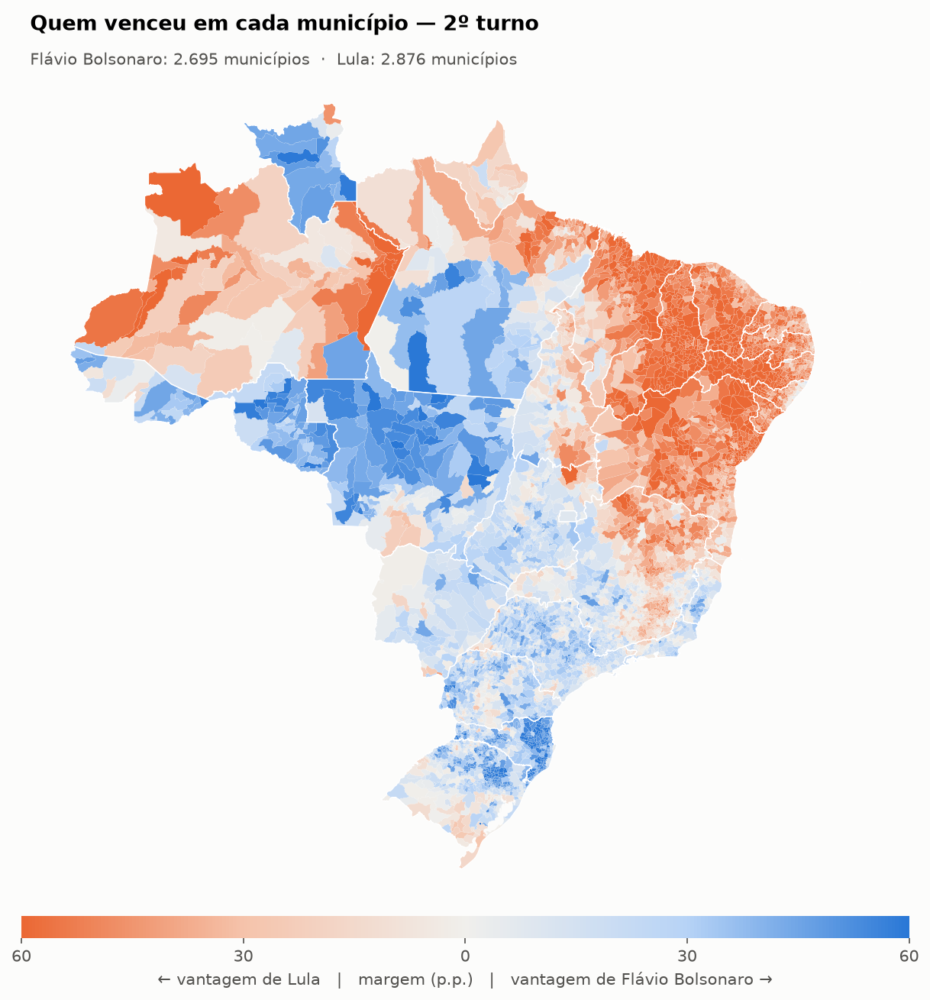
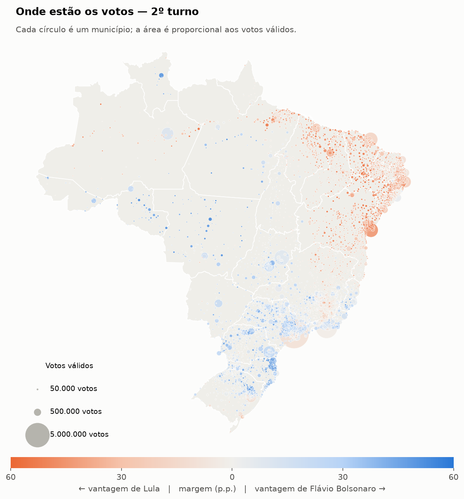
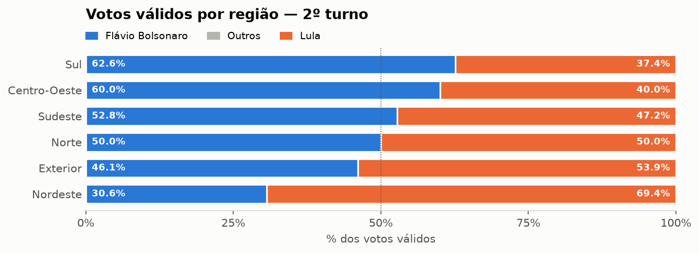
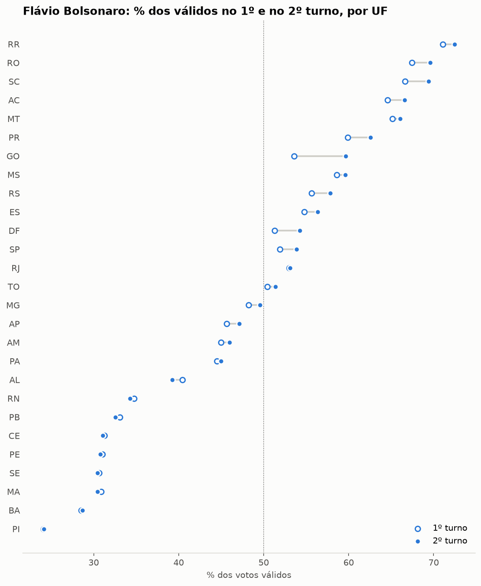
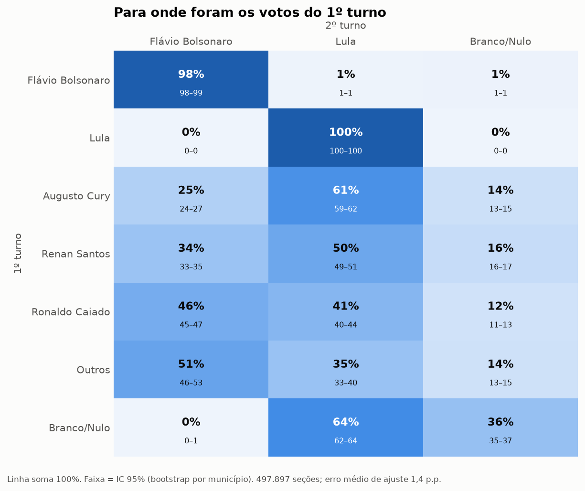
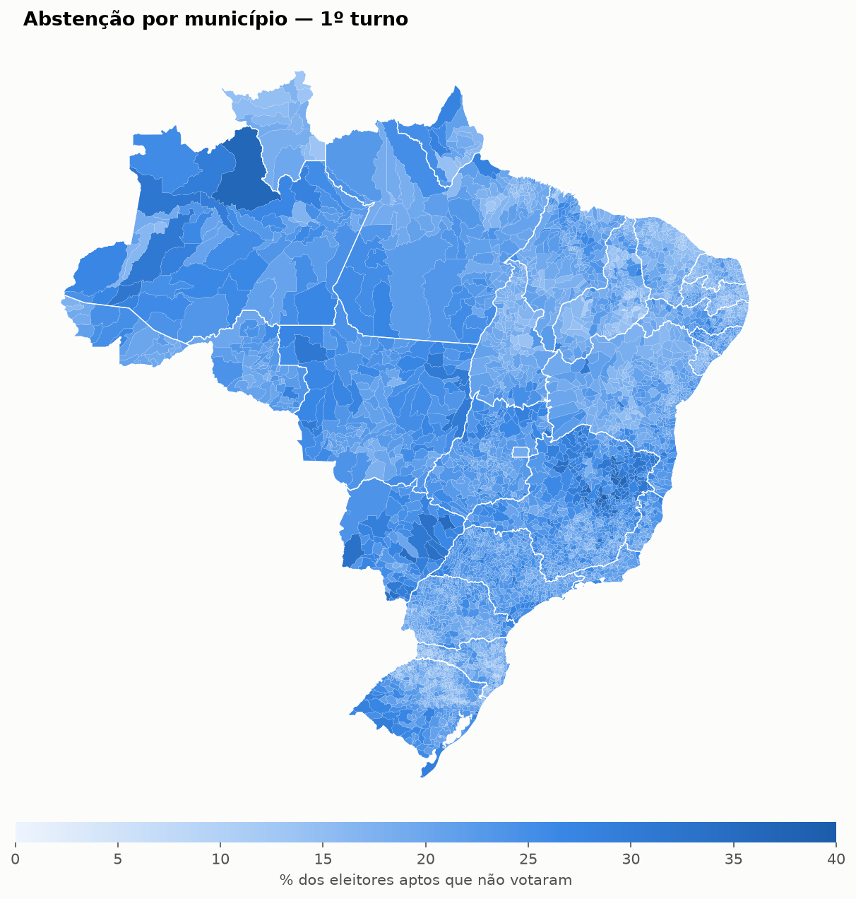
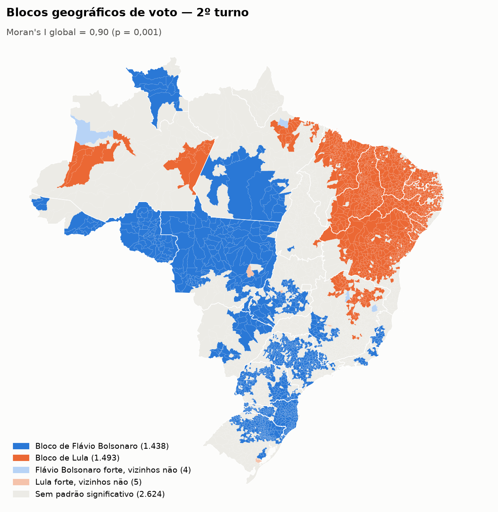
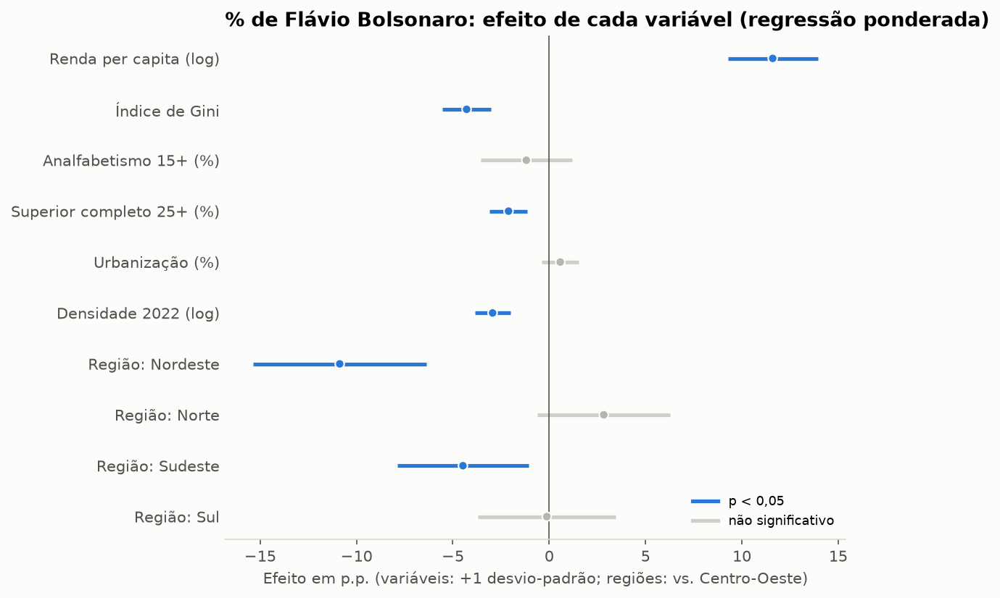
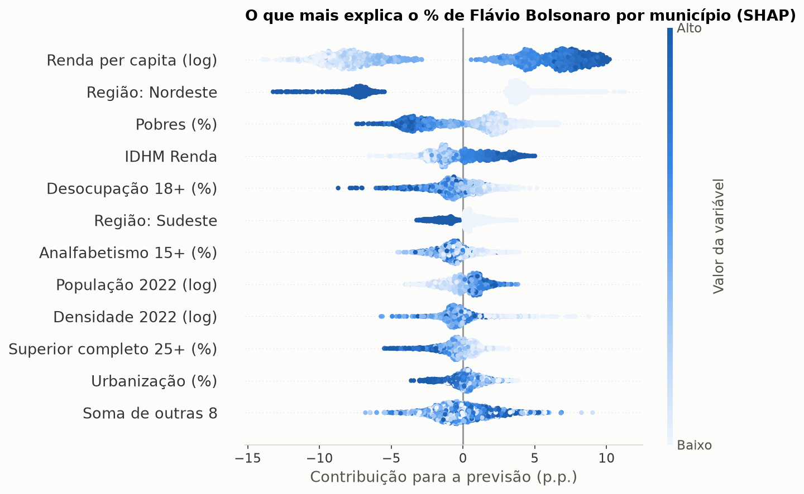

# Eleições presidenciais 2026: análise do 1º e 2º turnos

Análise da eleição presidencial brasileira de 2026 com dados abertos do TSE: resultado por região,
estado e município, abstenção, viradas entre turnos, transferência de votos estimada por seção
eleitoral, padrões geográficos, relação com indicadores socioeconômicos e comparação com 2022.

Python e pandas, com contrato de dados, testes automatizados, notebooks, app Streamlit e página web.

## Principais achados

| | 1º turno | 2º turno |
|---|---:|---:|
| **Lula** | 53.879.538 (45,16%) | **64.256.232 (51,79%)** |
| **Flávio Bolsonaro** | **56.104.503 (47,03%)** | 59.826.041 (48,21%) |
| Demais candidatos | 9.321.993 (7,81%) | – |
| Brancos e nulos | 5.969.801 | 4.153.801 |
| Votos totais | 125.275.835 | 128.236.074 |

*Percentuais sobre votos válidos. Fonte: TSE, votação por seção eleitoral; totais calculados por este projeto.*

- **Virada entre os turnos.** Flávio Bolsonaro terminou o 1º turno à frente por 2,2 milhões de votos
  (1,9 ponto); Lula venceu o 2º por 4,4 milhões (3,6 pontos). Do 1º para o 2º turno, Lula somou
  10,4 milhões de votos e Flávio, 3,7 milhões. Havia 9,3 milhões de votos em outros candidatos no
  1º turno, brancos e nulos caíram 1,8 milhão e o comparecimento subiu 3,0 milhões.
- **Geografia do voto.** No 2º turno, Lula venceu no Nordeste (69,4%) e Flávio no Sul (62,6%), no
  Centro-Oeste (60,0%) e no Sudeste (52,8%). O Norte ficou praticamente empatado (50,01% a 49,99%).
- **Abstenção** de 21,1% no 1º turno (33,5 milhões de eleitores aptos), com 62,7% no exterior.

Os números das análises avançadas (transferência de votos, Moran's I, modelos) ficam em
[`docs/achados.md`](docs/achados.md), gerado a partir dos dados.

## Mapas e gráficos

<table>
<tr>
<td width="50%"></td>
<td width="50%"></td>
</tr>
<tr>
<td><b>Quem venceu em cada município.</b> Azul e laranja indicam o vencedor; a intensidade, a margem.</td>
<td><b>Onde estão os votos.</b> No mapa por área, municípios grandes e pouco povoados dominam a imagem; aqui, cada círculo tem área proporcional aos votos válidos.</td>
</tr>
</table>

| Votos por região | Do 1º para o 2º turno, por estado |
|---|---|
|  |  |

### Para onde foram os votos do 1º turno



Estimativa por **inferência ecológica** com todas as seções eleitorais do país: cada linha mostra, de
cada 100 eleitores de uma opção do 1º turno, quantos foram para cada lado no 2º, com intervalo de
confiança de 95% (bootstrap). É um padrão médio estimado a partir de totais agregados; o voto é
secreto e ninguém é observado individualmente.

| Abstenção por município | Blocos geográficos de voto (LISA) |
|---|---|
|  |  |

| Voto e perfil dos municípios (regressão) | O que mais ajuda a prever o resultado (SHAP) |
|---|---|
|  |  |

As figuras são geradas por `python -m eleicoes.figuras_readme` e ficam em `docs/img/`.

## Perguntas

1. Como o voto e a abstenção mudaram do 1º para o 2º turno, e onde?
2. Qual a relação entre o resultado nos municípios e o perfil socioeconômico?
3. Para onde foram os votos dos candidatos eliminados no 1º turno?
4. O voto forma blocos geográficos? O que mudou em relação a 2022?

## Como rodar

Requer Python 3.11 ou mais recente.

```bash
python -m venv .venv
.venv\Scripts\activate             # Windows  (Linux/Mac: source .venv/bin/activate)
pip install -e ".[app,notebook,dev]"
python -m playwright install chromium   # opcional: permite o teste da página no navegador

python -m eleicoes.baixar          # dados do TSE (2026 e 2022) + fontes externas, com manifesto SHA-256
python -m eleicoes.processar                # processa o ano principal (config.yaml)
python -m eleicoes.processar --ano 2022     # processa a eleição de comparação

python -m eleicoes.figuras_readme  # figuras e achados do README (docs/)
pytest                             # 74 testes (inclui a página no navegador e conferências nos seus dados reais)
```

Depois, abra os notebooks em `notebooks/` e rode "Run All":

| Notebook | Conteúdo |
|---|---|
| `01_resultados.ipynb` | resultado nacional, participação, região, UF, abstenção, mapas por área e proporcional, demais candidatos, 1º → 2º turno |
| `02_ciencia_de_dados.ipynb` | inferência ecológica por seção, Moran's I e LISA, regressão ponderada, gradient boosting + SHAP, swing 2022 → 2026 |

App interativo: `streamlit run app/streamlit_app.py`

## Página web (GitHub Pages)

Página estática com o resultado por município: barra de apuração, mapa interativo (quem venceu,
abstenção e variação desde 2022; por área ou proporcional aos votos), barras por UF e região,
histogramas, tabela pesquisável e uma seção de **análises avançadas** (transferência de votos,
blocos geográficos, regressão e gradient boosting), cada uma com explicação e ressalvas.

```bash
python -m eleicoes.exportar_site            # gera site/data/ (~1 a 3 minutos com as análises avançadas)
python -m http.server -d site 8000          # ver localmente em http://localhost:8000
```

Publicação, feita uma vez: no GitHub, abra **Settings → Pages** e, em *Source*, escolha **GitHub Actions**.
Depois, a cada `git push` que altere `site/`, o workflow `Publicar página` atualiza o site em
`https://heltonsoares93.github.io/eleicoes-2026-dataanalyzer/`.

Os arquivos de `site/data/` têm só números agregados de dados públicos (menos de 1 MB depois da
compressão do GitHub Pages) e devem ir no commit. Os dados brutos continuam fora do repositório.
A página não depende de serviços externos: a biblioteca D3 fica em `site/vendor/`.

**Vindo da versão anterior (scripts soltos em `src/`):** apague `src/processar_votacao.py`,
`src/analise.py`, `requirements.txt`, `notebooks/01_analise_turnos.ipynb` e o conteúdo de
`data/processed/`. O zip do TSE que já está em `data/raw/` é reaproveitado (não baixa de novo).

**Quando o TSE atualizar um arquivo** (por exemplo, publicar o 2º turno):
`python -m eleicoes.baixar --forcar` e `python -m eleicoes.processar`.

## Dados

| Fonte | Uso | Onde fica |
|---|---|---|
| TSE — Votação por seção eleitoral (Presidente) | votos por candidato, branco e nulo | `data/raw/` |
| TSE — Detalhe da apuração por município e zona | eleitores aptos, comparecimento, abstenção | `data/raw/` |
| Malha municipal IBGE (`tbrugz/geodata-br`) | mapas | `data/external/` |
| Correspondência TSE ↔ IBGE (`betafcc/Municipios-Brasileiros-TSE`) | cruzar códigos de município | `data/external/` |
| Atlas do Desenvolvimento Humano (PNUD/IPEA/FJP, Censo 2010) | IDHM, renda, escolaridade, desigualdade | `data/external/` |
| Censo 2022 (`CaiqueDourado/municipios-e-estados-do-brasil`) | população, densidade, coordenadas | `data/external/` |

As fontes externas estão fixadas em um commit específico e conferidas por SHA-256 no
`config.yaml`. Cada download fica registrado em `data/manifesto.json` (URL, data, tamanho, hash).

## Estrutura

```
config.yaml            ano analisado, ano de comparação, URLs e hashes das fontes
src/eleicoes/
  baixar.py            download com manifesto e verificação de hash
  processar.py         leitura dos zips do TSE (pandas, em blocos) e bases limpas em parquet
  esquema.py           contrato de dados (pandera): tipos, faixas e unicidade
  dados.py             leitura das bases processadas e das fontes externas
  resultados.py        cálculos: finalistas, percentuais, margens, abstenção, swing
  transferencia.py     inferência ecológica por seção (com bootstrap)
  espacial.py          Moran's I e LISA
  modelo.py            regressão ponderada (WLS) e gradient boosting + SHAP
  graficos.py          gráficos e mapas (paleta acessível a daltônicos)
  exportar_site.py     dados da página web (site/data/)
  figuras_readme.py    figuras e achados do README (docs/)
notebooks/             análises
app/                   app Streamlit
site/                  página web estática (HTML, CSS, JavaScript + D3)
docs/                  figuras e achados do README
tests/                 testes (pytest) com amostra sintética no formato exato do TSE
```

## Qualidade

- **Contrato de dados:** o processamento valida cada base antes de salvar (tipos inteiros
  comuns, votos ≥ 0, turno ∈ {1, 2}, sem duplicatas). Problemas aparecem no processamento,
  com a coluna e o motivo, e não depois, no notebook.
- **Validação cruzada:** votos totais (votação por seção) x comparecimento (detalhe da
  apuração), dois arquivos independentes do TSE, conferidos município a município.
- **Conferência com o resultado oficial:** preencha `oficial:` no `config.yaml` e
  `pytest -m dados_reais` compara os totais.
- **Testes:** amostra sintética no formato exato do TSE (Latin 1, `;`, `#NULO`, exterior e
  trânsito) com estrutura conhecida; os testes verificam se a inferência ecológica e a
  análise espacial recuperam o padrão plantado. Os notebooks, o app e a página web (num navegador
  de verdade, via Playwright) são executados nos testes.
- **CI:** GitHub Actions roda lint (ruff) e testes em Linux e Windows a cada push.
- **Pre-commit:** `pre-commit install` ativa ruff e `nbstripout`, que limpa as saídas dos notebooks antes do commit.

## Notas metodológicas

- Percentuais sobre votos válidos, como no resultado oficial.
- Exterior (`ZZ`) e voto em trânsito (`VT`) entram nos totais, mas não nos mapas.
- **Inferência ecológica:** estima padrões médios a partir de agregados, não o voto de cada
  pessoa. Supõe comportamento semelhante entre seções da mesma UF. Quem deixou de votar entre
  os turnos não é modelado explicitamente (o arquivo por seção não traz eleitores aptos).
- **Socioeconômico:** indicadores do Atlas são do Censo 2010. Associação entre municípios não
  é causalidade. A validação do gradient boosting é por UF, para não superestimar o desempenho
  por vizinhança geográfica.
- Malha municipal de 2010: os 6 municípios criados depois aparecem em cinza nos mapas.
